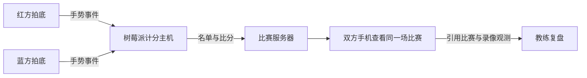

# 随芯拍 · RallyMate

随芯拍是一套羽毛球智能计分与复盘系统。球员双击拍底加分、三连击撤销，双方手机同步查看树莓派确认的比分。赛后可以打开比赛回放，引用这场比赛向 AI 教练提问。

**[打开参赛展示，体验双拍计分](https://rallymate-ai-badminton-kit.github.io/rallymate-showcase/)**

## 一场比赛的数据流

## 运行公开示例

使用 Node.js 18 或更高版本，在仓库目录执行 `node example.mjs`。例子依次验证红方加分、同一事件重传、蓝方加分、蓝方撤销，最终比分为 1 比 0。

[计分逻辑](score.js) 与[示例事件](example.mjs)均可直接阅读。网页使用同一份计分逻辑，在浏览器本地运行。本仓提供独立编写的教学示例，展示单局事件处理。
